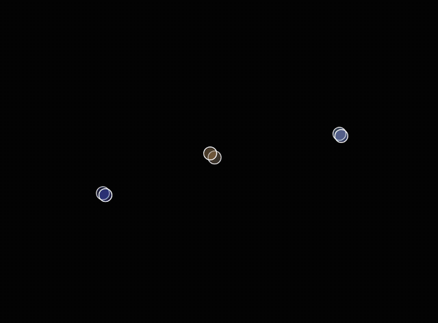

# Threebodies

This is a physics simulation of the three-body problem

## You can try it here!

https://gabrigua.github.io/ThreeBodies/

## Features

 In this physics simulation you can:
  - Learn more about this experiment
  - Load ready-made presets of stable orbits
  - Play around with the amount of planets and speed
  - Search for new stable orbits using the "Automatic Reset" checkbox
  - Save your favourite runs as JSON files and load them later
  
## Examples

In [Example](Example) you can find already made preset that you can load in the simulator and watch

## The story

This was my last project for Hack Club as a teen, a sort of "last dance", and I'm really proud of what I achieved with it.
At first I felt completely out of my depth: I hadn't coded in a while, and I had never built anything like this before.
Once I got started, I found a great tutorial on YouTube that helped me take the first steps. Then, piece by piece, I built the whole project, and now, sadly, I have to grow up and get a job xD

## Built with

Vanilla Javascript for Newtonian gravity with softening, symplectic Euler integrator with sub-steps

[p5.js](https://p5js.org/) for rendering and animation loop

HTML5 & CSS3

Hosted with Github Pages

## Credits

- Learning resources: [The Nature of Code](https://natureofcode.com/) and The Coding Train
- Figure-eight initial conditions: Chenciner & Montgomery (2000)
- The prese orbit files were generated with AI assistance (Claude) and tested in the simulator

### Made by Gabbs for Cubed, A Hack Club Event

